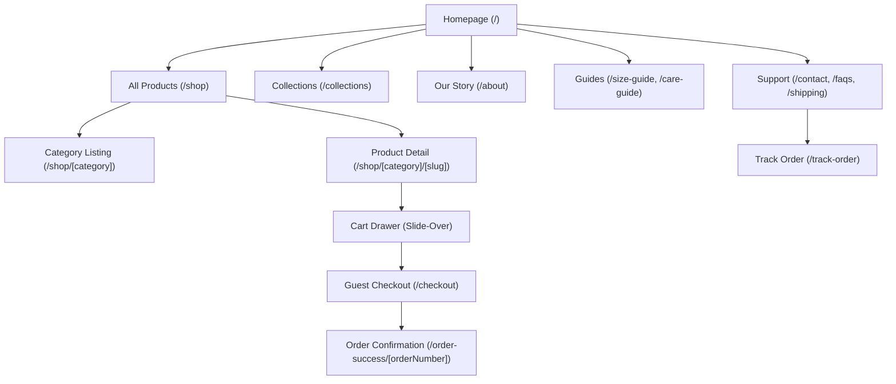
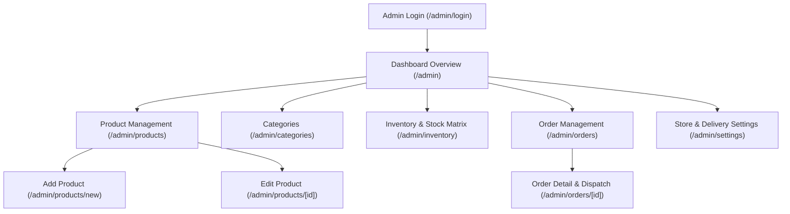
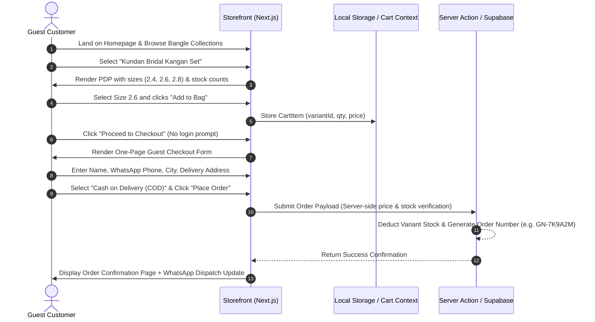
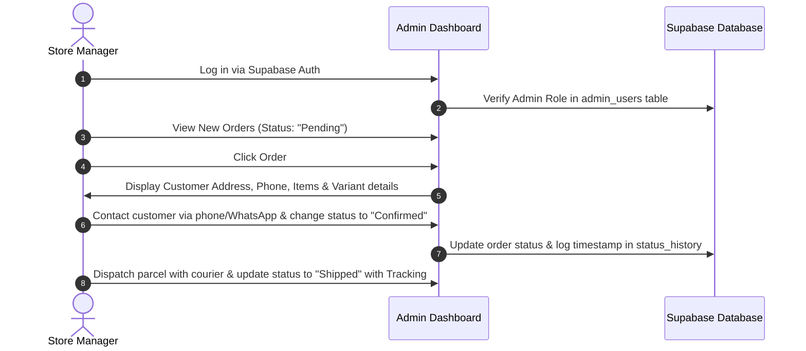
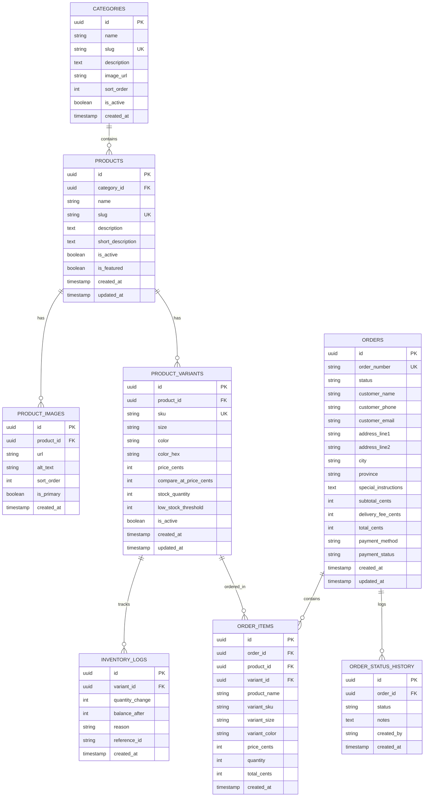

# PHASE 1 — GULNAAR by MK
## Requirements, UI/UX Planning & Design Foundation Blueprint

---

### Executive Summary

**GULNAAR by MK** is a bespoke, luxury handmade bangles e-commerce brand celebrating artisanal South Asian heritage and contemporary jewellery craftsmanship. 

This document defines the complete architectural foundation, brand identity, user experience design, database schema, motion principles, and 5-phase roadmap for the project. In strict alignment with Phase 1 constraints, this document focuses exclusively on planning, specification, and foundational design assets without implementing storefront features prematurely.

---

### 1. Brand & Visual Direction Proposal

#### Brand Essence & Tone
- **Archetype:** Artisanal Elegance, Heritage Craft, Modern Femininity.
- **Brand Personality:** Refined, welcoming, trustworthy, culturally rooted yet minimalist.
- **Core Aesthetic Pillars:**
  1. *Tactile Warmth:* Moving away from clinical cold white (#FFFFFF) to warm ivory (#FAF7F2) and parchment tones (#F5F0E8) that mimic raw silk, handmade paper, and velvet jewellery boxes.
  2. *Rich Royal Accents:* Deep Burgundy (#7A2D3C) derived from traditional bridal pomegranate and carmine dyes, paired with muted heritage gold (#B8976A).
  3. *Generous Space & Restraint:* Generous negative space that allows the intricate details of handcrafted Kundan, Meenakari, and filigree bangles to take center stage without visual clutter.
  4. *Editorial Typography:* High-contrast serif headlines paired with ultra-legible, geometric sans-serif for prices, product details, and forms.

---

### 2. Color Palette & Accessible Combinations

```
┌────────────────────────────────────────────────────────────────────────┐
│                          GULNAAR COLOR PALETTE                         │
│                                                                        │
│   Ivory Base       Parchment       Deep Burgundy     Muted Gold        │
│    #FAF7F2          #F5F0E8           #7A2D3C          #B8976A         │
│   (Warm Canvas)    (Card Surface)   (Primary Brand)   (Highlights)     │
│                                                                        │
│   Charcoal Text    Muted Stone     Success Leaf      Error Crimson     │
│    #2C2C2C          #6B6462           #5A7A60          #C44B4B         │
│   (Primary Text)   (Secondary Text) (In-Stock / OK)   (Alerts / Sale)  │
└────────────────────────────────────────────────────────────────────────┘
```

#### Color Specifications & Roles

| Token Name | Hex Code | Role & Usage | WCAG Contrast Ratio |
| :--- | :--- | :--- | :--- |
| `--color-bg-primary` | `#FAF7F2` | Global page background (warm ivory) | Canvas baseline |
| `--color-bg-secondary`| `#F5F0E8` | Product cards, filter panels, section contrasts | Canvas contrast |
| `--color-bg-surface`  | `#F0EBE3` | Borders, subtle dividers, pill backings | UI Surface |
| `--color-brand`       | `#7A2D3C` | Primary brand accent: CTAs, active states, key titles | 6.8:1 on #FAF7F2 (Passes AAA Large, AA Normal) |
| `--color-brand-hover` | `#5E1F2E` | Button hover and active press state | 9.4:1 on #FAF7F2 (Passes AAA) |
| `--color-brand-light` | `#F5E6E9` | Badges, alert backgrounds, subtle highlights | Contrast background |
| `--color-gold`        | `#B8976A` | Decorative highlights, star icons, border accents | 3.2:1 (Decorative & Large elements only) |
| `--color-gold-light`  | `#D4BE94` | Hover states on gold elements, soft borders | Decorative |
| `--color-text`        | `#2C2C2C` | Primary body and headline text (deep charcoal) | 12.6:1 on #FAF7F2 (Passes AAA) |
| `--color-text-secondary`| `#6B6462`| Subtitles, metadata, SKUs, breadcrumbs | 5.2:1 on #FAF7F2 (Passes AA) |
| `--color-border`      | `#E5DED5` | Card borders, input field borders, table lines | 1.3:1 (Non-text contrast requirement met) |
| `--color-border-strong`| `#C9C0B4`| Focused input borders, active pills | 1.8:1 (Input outlines) |
| `--color-success`     | `#5A7A60` | In-stock tags, order confirmed status | 4.6:1 on #FAF7F2 (Passes AA) |
| `--color-error`       | `#C44B4B` | Out of stock, validation errors, sale tags | 4.8:1 on #FAF7F2 (Passes AA) |
| `--color-warning`     | `#C4932A` | Low stock warnings, pending status | 3.5:1 (Paired with dark text) |

---

### 3. Typography System

The typography pairs an editorial high-contrast serif with a versatile sans-serif.

- **Primary Display / Heading:** `Playfair Display` (Serif — weights 400, 500, 600, 700)
- **Primary Body / UI / Sans:** `Inter` (Sans-Serif — weights 300, 400, 500, 600, 700)

#### Type Hierarchy Scale

| Level | Font Family | Size (Desktop) | Size (Mobile) | Line Height | Letter Spacing | Purpose / Usage |
| :--- | :--- | :--- | :--- | :--- | :--- | :--- |
| **Hero Title** | Playfair Display | 52px (3.25rem) | 36px (2.25rem) | 1.15 | -0.02em | Homepage Hero headline |
| **Heading 1** | Playfair Display | 38px (2.375rem)| 28px (1.75rem) | 1.2 | -0.015em| Category titles, Product title on PDP |
| **Heading 2** | Playfair Display | 28px (1.75rem) | 22px (1.375rem)| 1.25 | -0.01em | Section titles, Cart/Checkout section heads |
| **Heading 3** | Playfair Display | 22px (1.375rem)| 18px (1.125rem)| 1.3 | 0em | Card titles, Modal headers |
| **Subheading** | Inter (Medium) | 16px (1.0rem)  | 15px (0.938rem)| 1.4 | +0.02em | Section lead-ins, curated collection badges |
| **Body Large** | Inter (Regular)| 18px (1.125rem)| 16px (1.0rem)  | 1.6 | 0em | Brand story, featured quotes |
| **Body Base** | Inter (Regular)| 15px (0.938rem)| 14px (0.875rem)| 1.55| 0em | Product descriptions, checkout forms, policies |
| **Body Small** | Inter (Regular)| 13px (0.813rem)| 12px (0.75rem) | 1.5 | +0.01em | Metadata, SKU, stock count, helper text |
| **Caption / Badge**| Inter (SemiBold)| 11px (0.688rem)| 10px (0.625rem)| 1.2 | +0.06em (Uppercase)| Badges ("NEW", "SALE", "HANDMADE") |
| **Price (Hero)**| Inter (SemiBold)| 24px (1.5rem)  | 20px (1.25rem) | 1.2 | -0.01em | PDP Main Price ("PKR 8,900") |
| **Price (Card)**| Inter (Medium) | 16px (1.0rem)  | 15px (0.938rem)| 1.2 | 0em | Product card price |

---

### 4. Spacing, Sizing, Borders, Radii & Elevation

#### Spacing System (8pt Grid)
- `4px` (`0.25rem`): Micro gaps (badge padding, icon-text spacing)
- `8px` (`0.5rem`): Form input inner paddings, compact list gaps
- `12px` (`0.75rem`): Card text element spacing
- `16px` (`1.0rem`): Component padding (mobile), standard margins
- `24px` (`1.5rem`): Card inner padding, grid gutters
- `32px` (`2.0rem`): Section gaps (mobile), header height buffers
- `48px` (`3.0rem`): Sub-section vertical rhythm
- `64px` (`4.0rem`): Section vertical padding (tablet/desktop)
- `96px` (`6.0rem`): Hero & feature section vertical buffers

#### Border Radii
- `var(--radius-sm)` = `4px`: Badges, tags, form controls, variant chips.
- `var(--radius-md)` = `8px`: Buttons, select dropdowns, search inputs, alert boxes.
- `var(--radius-lg)` = `12px`: Product cards, cart item panels, checkout summary cards.
- `var(--radius-xl)` = `16px`: Slide-out drawers, modal dialogues, hero picture containers.
- `var(--radius-full)` = `9999px`: Circular icon buttons, color swatch selectors, pill chips.

#### Elevation & Shadows
- **Flat Surface:** `border: 1px solid var(--color-border)` (Default for high-end look).
- **Shadow Sub:** `0 1px 3px rgba(44, 44, 44, 0.04)` (Card resting state).
- **Shadow Elevate:** `0 8px 24px -4px rgba(44, 44, 44, 0.08)` (Card hover, dropdown menus).
- **Shadow Drawer / Modal:** `0 20px 48px rgba(44, 44, 44, 0.16)` (Cart slide-over, popups).

---

### 5. Motion & Interaction System

Motion in GULNAAR by MK is designed to be **deliberate, restrained, and luxurious**, never rushed or disorienting.

#### Motion Tokens
- `--ease-out`: `cubic-bezier(0.16, 1, 0.3, 1)` (Decelerating — used for entries, drawer slide-ins)
- `--ease-in-out`: `cubic-bezier(0.65, 0, 0.35, 1)` (Smooth transitions between states)
- `--duration-fast`: `150ms` (Button press, color swatch toggle, focus ring)
- `--duration-normal`: `250ms` (Product card hover, dropdown expand, badge transitions)
- `--duration-slow`: `400ms` (Slide-out cart drawer, modal backdrop, page fade)

#### Interaction Guidelines
1. **Product Card Image Zoom:** Subtle 3% scale on image container hover (`scale(1.03)`) with a 300ms ease. No jerky borders or jumping heights.
2. **Button Micro-States:** 
   - Normal: Solid Burgundy background or elegant bordered gold.
   - Hover: 5% darker tint + smooth transition.
   - Pressed: `scale(0.98)` for tactile physical feedback.
   - Disabled / Out of Stock: Reduced opacity (0.5), cursor `not-allowed`.
3. **Cart Drawer Transition:** Slides in from the right viewport edge with `--ease-out` (350ms). Background overlay fades to `rgba(44, 44, 44, 0.45)`.
4. **Accessible Reduced Motion:** When `prefers-reduced-motion: reduce` is enabled:
   - All `transform` translations and scales are disabled (`transform: none !important;`).
   - Durations are collapsed to instant or gentle opacity-only changes (`opacity: 1; transition: none;`).

---

### 6. Component Inventory

```
UI COMPONENT ARCHITECTURE
├── 1. Primitives (Atomic)
│   ├── Button (Primary, Secondary, Outline, Ghost, Gold)
│   ├── Badge (Brand, Gold, Success, Error, Warning, Neutral)
│   ├── Input / Textarea (Floating label, error state, helper text)
│   ├── Select / Dropdown (Custom styled with Chevron)
│   ├── Radio & Checkbox (Custom styled for COD & Terms)
│   ├── Skeleton (ProductCard, Detail, Table row)
│   └── EmptyState (Search, Cart, Wishlist, Order History)
│
├── 2. Layout & Global
│   ├── Header / Navbar (Sticky, announcement bar, brand logo, nav links, cart pill)
│   ├── MobileDrawer (Slide-out navigation for small screens)
│   ├── Footer (Artisan story snippet, quick links, policies, social, copyright)
│   └── Container (Constrained width wrapper: sm, md, lg, xl, full)
│
├── 3. Product & Catalog
│   ├── ProductCard (Thumbnail, quick tag, title, price, hover secondary image)
│   ├── ProductGrid (Responsive auto-fit grid 2-col mobile, 4-col desktop)
│   ├── ProductGallery (Thumbnail carousel / sticky multi-angle view)
│   ├── VariantSelector (Bangle size pills: 2.4, 2.6, 2.8; color swatches)
│   ├── QuantityPicker (Minus, display number, plus with stock limit validation)
│   └── StockBadge (In Stock, "Only 3 left", Out of Stock)
│
├── 4. Cart & Checkout
│   ├── CartDrawer (Slide-over drawer with item list, order summary, free delivery tracker)
│   ├── CartItemRow (Thumb, variant spec, unit price, quantity picker, remove button)
│   ├── CheckoutSummary (Items review, subtotal, delivery fee, total in PKR)
│   └── OrderSuccessCard (Printable receipt card with Order Number, WhatsApp CTA)
│
└── 5. Admin Interface
    ├── AdminSidebar (Dashboard, Products, Categories, Orders, Inventory, Settings)
    ├── AdminHeader (Breadcrumb, logged-in user profile, quick store link)
    ├── DataTable (Sortable columns, status pills, action buttons, pagination)
    ├── StatCard (Metric count, percentage delta, icon)
    └── StatusUpdater (Dropdown for Pending → Confirmed → Shipped → Delivered)
```

---

### 7. Information Architecture & Sitemaps

#### Storefront Sitemap



- **Essential First-Release (MVP):**
  - Homepage (`/`)
  - Catalog / Shop with Category Filter (`/shop`, `/shop/[category]`)
  - Product Detail Page (`/shop/[category]/[slug]`)
  - Cart Slide-over Drawer & Full Cart View (`/cart`)
  - Single-Step Guest Checkout (`/checkout`)
  - Order Confirmation with Unique Order ID (`/order-success/[orderNumber]`)
  - Order Tracking Page (`/track-order`)
  - Essential Policies: Size Guide, Care Instructions, Delivery/Exchange Policy.
- **Post-MVP Enhancements:**
  - Customer review submissions with photo uploads.
  - Interactive wrist-measurement visual calculator.
  - Gift wrapping & handwritten note personalization step.

#### Admin Sitemap



---

### 8. Main Customer & Admin Journeys

#### Customer Journey: Guest Discovery to Cash on Delivery (COD)



#### Admin Journey: Order Processing & Inventory Management



---

### 9. Wireframe Layout Descriptions

#### 1. Homepage (`/`)
- **Top Announcement Bar (32px):** "Free Delivery Across Pakistan on Orders Over PKR 5,000 | Handcrafted with Love"
- **Header (72px):** Left: Mobile menu toggle / Navigation links (Collections, Bridal, Daily Wear, Gift Sets). Center: High-elegance brand wordmark **"GULNAAR by MK"**. Right: Search modal trigger, Cart icon with live badge counter.
- **Hero Section (Full height - 80vh):** High-resolution lifestyle banner depicting handcrafted bridal bangles on traditional silk fabric. Heading: *"Artisanal Bangles Crafted for Your Sacred Celebrations"*. Subheading with CTA button: *"Explore Bridal Collection"*.
- **Curated Category Carousel / Grid:** 4 visual category cards (Bridal, Everyday Elegance, Statement, Kundan & Meenakari) with circular or arched imagery.
- **Featured / Best Sellers Grid (4 Columns):** Product cards featuring primary image, title, starting price in PKR, and subtle "Quick View" / "View Details".
- **Brand Story Banner:** Warm tinted background (`#F5F0E8`), authentic craftsmanship story text, gold icon highlights (100% Hand-set stones, Solid Brass Core, Hypoallergenic plating).
- **Footer:** Brand mission snippet, Customer Care links (Size Guide, Care, Return Policy), WhatsApp Contact link, Secure Payment badge (Cash on Delivery).

#### 2. Shop & Product Listing (`/shop`, `/shop/[category]`)
- **Breadcrumbs:** `Home / Collections / Bridal`
- **Page Header:** Category title in Playfair Display, editorial 1-sentence description, item count indicator ("Showing 12 pieces").
- **Filter & Sort Toolbar:**
  - Left: Filter drawer button (Mobile) / Horizontal chips (Desktop: Price range, Bangle Size, In-Stock only).
  - Right: Sort dropdown ("Featured", "Price: Low to High", "Price: High to Low", "Newest").
- **Responsive Product Grid:** 2 columns on mobile, 3 columns on tablet, 4 columns on desktop.
- **Empty State:** If filters return 0 results: An elegant illustration with "No pieces match your selection", clear filter button.

#### 3. Product Detail Page (PDP) (`/shop/[category]/[slug]`)
- **Left Column (Desktop 60%):** Multi-angle photo gallery (Main zoomable preview + 4 vertical thumbnails).
- **Right Column (Desktop 40% - Sticky):**
  - Category breadcrumb & Title in Playfair Display.
  - Price indicator (`PKR 8,900`) + Compare-at strike-through price if on sale.
  - Short description highlighting materials (e.g. 24K Gold-dipped brass, hand-carved Kundan).
  - **Size Selector:** Traditional bangle sizes (`2.4`, `2.6`, `2.8`, `2.10`) rendered as interactive circular pills. Below: "Not sure about your size? [View Bangle Size Guide]".
  - **Color / Finish Selector:** Swatches for finish (Antique Gold, Champagne, Rose Gold).
  - **Stock Indicator:** Dynamic badge: "In Stock" (green) or "Only 2 sets remaining" (amber).
  - **Action Button:** Full-width primary CTA *"Add to Bag"* in Deep Burgundy.
  - **Trust Badges:** 3-day return/exchange guarantee, Free delivery over PKR 5,000, 100% Cash on Delivery.
  - **Expandable Accordions:** Product Details & Specifications, Care Instructions, Shipping Times.

#### 4. Cart Slide-Out Drawer
- **Header:** "Your Shopping Bag (2 items)" + Close button.
- **Free Shipping Progress Meter:** Dynamic bar showing *"Add PKR 1,100 more to unlock Free Delivery!"*.
- **Items List:** Scrollable list of items, showing image thumbnail, product title, chosen size (e.g. `Size: 2.6`), price, `[-] 1 [+]` quantity controls, and delete icon.
- **Bottom Summary:** Subtotal, estimated delivery note ("Cash on Delivery calculated next"), and large Burgundy button: *"Proceed to Checkout"*.

#### 5. Guest Checkout (`/checkout`)
- **Single-Page Distraction-Free Layout:**
  - Header displays only the GULNAAR logo to minimize abandonment.
  - **Section 1: Contact Information:** Full Name, WhatsApp Mobile Number (for delivery confirmation), Email (optional for receipt).
  - **Section 2: Shipping Destination:** Complete Street Address, House/Apartment #, Landmark/Sector, City dropdown (Karachi, Lahore, Islamabad, etc.), Province.
  - **Section 3: Delivery Options:** Standard Courier (3–5 business days) — PKR 250 (or FREE if subtotal > PKR 5,000).
  - **Section 4: Payment:** Explicitly selected "Cash on Delivery (COD) — Pay when you receive your parcel".
  - **Order Summary Sidebar (Right on desktop):** Breakdown of items, subtotal, delivery fee, grand total in PKR.
  - **CTA:** *"Complete Order via Cash on Delivery"*.

#### 6. Admin Overview Dashboard (`/admin`)
- **Top Bar:** Quick stats summary (Today's Sales, Pending Orders count, Out of Stock alerts).
- **Recent Orders Data Table:** Columns: Order #, Customer Name, City, Items Count, Total PKR, Status (Pill: Pending, Confirmed, Dispatched, Delivered), Action (View/Edit).
- **Inventory Warning Widget:** Lists bangle variants that have breached the low-stock threshold (<= 3 sets remaining).

---

### 10. Database Schema & Relational Architecture

The database is designed for **Supabase (PostgreSQL)** with Row Level Security (RLS) enabled.



#### Key Architecture Principles for the Data Layer
1. **Price Storage in Cents:** All monetary values are stored as integers (`price_cents`) to eliminate floating-point rounding errors. (e.g., PKR 8,900 is stored as `890000`).
2. **Historical Immutability:** `ORDER_ITEMS` snapshots the `product_name`, `variant_sku`, `variant_size`, and `price_cents` at checkout time. Future price changes or deleted products will not alter past orders.
3. **Inventory Isolation:** Stock is managed per variant (SKU level), allowing accurate inventory tracking for individual bangle sizes (e.g. Size 2.4 vs 2.6).
4. **Security & Access Control (RLS):**
   - Public storefront access: Read-only for `CATEGORIES`, `PRODUCTS`, `PRODUCT_IMAGES`, and active `PRODUCT_VARIANTS`.
   - Customer checkout: Insert-only permission on `ORDERS` and `ORDER_ITEMS` through server-validated Server Actions.
   - Admin access: Full CRUD managed via Supabase Service Role on server side, protected by authenticated session checks in Next.js Middleware.

---

### 11. Responsive Design Specifications

| Viewport | Range | Grid Layout | Navigation | Touch Targets | Container Padding |
| :--- | :--- | :--- | :--- | :--- | :--- |
| **Mobile** | `< 640px` | 1-col (Hero), 2-col (Products) | Hamburger drawer + sticky bottom bar | Min `44px x 44px` | `16px` (1rem) |
| **Tablet** | `640px - 1024px` | 2-col to 3-col (Products) | Condensed header, compact search | Min `44px x 44px` | `24px` (1.5rem) |
| **Desktop**| `> 1024px` | 4-col (Products), 60/40 (PDP) | Full horizontal navigation bar | Standard cursor | `32px` to `48px` (Max 1280px) |

---

### 12. Accessibility (WCAG 2.1 AA) Requirements

1. **Color Contrast:** All body text meets or exceeds 4.5:1 ratio against backgrounds; all headlines and large text meet 3:1 ratio.
2. **Keyboard Navigability:** Visible focus outlines (`ring-2 ring-brand ring-offset-2`) on all interactive controls (buttons, links, inputs, swatches).
3. **Screen Readers:**
   - Descriptive `alt` attributes for all product imagery (e.g., "Front view of Kundan Bridal Kangan Set in 24K gold plated finish").
   - `aria-expanded` and `aria-controls` on mobile navigation drawers and product accordion drawers.
   - `aria-live="polite"` on cart counter updates and stock status indicators.
4. **Form Semantics:** All inputs paired with `<label>` tags, with `autocomplete` enabled for name, phone, and address to simplify mobile checkout.

---

### 13. Performance & SEO Strategy

- **Next.js 16 Partial Prerendering (PPR):** Static shell for header, category menus, and footer with dynamic streaming for cart counts and inventory status.
- **Image Optimization:** Next.js `<Image />` component with `sizes` specification, automatic AVIF/WebP conversion, and low-quality image placeholders (blur data URLs).
- **Core Web Vitals Budget:**
  - Largest Contentful Paint (LCP) < 2.0s
  - First Input Delay (FID) / Interaction to Next Paint (INP) < 150ms
  - Cumulative Layout Shift (CLS) < 0.05
- **Structured Data (Schema.org):** JSON-LD schema on all Product Detail Pages (`@type: "Product"` with price in PKR, availability, and image gallery) for rich Google search snippets.

---

### 14. 5-Phase Project Roadmap & Boundaries

```
┌───────────────────────────────────────────────────────────────────────────────────┐
│                           5-PHASE DEVELOPMENT ROADMAP                             │
│                                                                                   │
│  [PHASE 1] Requirements, Planning, UI/UX & Design Foundation    <-- CURRENT       │
│  [PHASE 2] Storefront UI, Layout & Catalog Presentation                           │
│  [PHASE 3] Interactive Product Detail, Variant Engine & Cart System               │
│  [PHASE 4] One-Page Guest COD Checkout, Order Tracking & Supabase Integration      │
│  [PHASE 5] Protected Admin Dashboard, Inventory Management & Launch Polish       │
└───────────────────────────────────────────────────────────────────────────────────┘
```

#### Detailed Phase Scope Boundaries

- **PHASE 1 (Current): Planning & Foundation**
  - Brand identity, design tokens, typography, colors, layout rules.
  - Complete database schema definition and TypeScript types.
  - Sample mock catalog datasets and core utility helpers.
  - Architectural blueprint and acceptance checklist.
  - *Boundary:* No full page assembly or live backend operations.

- **PHASE 2: Storefront Presentation & Catalog**
  - Global Header/Navbar with desktop and mobile navigation.
  - Global Footer with brand story and customer service links.
  - High-converting Homepage with Hero, Collections, and Best Sellers.
  - Catalog / Shop listing page (`/shop`) with category filtering and sorting.
  - *Boundary:* Product clicking routes to PDP, but cart and checkout are mocked.

- **PHASE 3: PDP, Variant Engine & Shopping Cart**
  - Full Product Detail Page (`/shop/[slug]`) with image gallery and zoom.
  - Interactive bangle size selector (`2.4`, `2.6`, `2.8`) and finish selector.
  - Real-time stock status badge and quantity selector.
  - Slide-out Cart Drawer with persistence (Local Storage / Context).
  - *Boundary:* Checkout button navigates to checkout placeholder.

- **PHASE 4: Guest Checkout, Cash on Delivery & Supabase Data Layer**
  - Dedicated one-page guest checkout (Customer details, shipping, COD).
  - Server Actions for validating stock, prices, and order placement.
  - Order success receipt screen (`/order-success/[orderNumber]`).
  - Order tracking page (`/track-order`) with phone/order lookup.
  - Live Supabase PostgreSQL database migration.
  - *Boundary:* Admin area remains placeholder.

- **PHASE 5: Admin Dashboard & Launch Readiness**
  - Supabase authentication for store managers (`/admin/login`).
  - Product CRUD with image uploads to Supabase Storage.
  - Inventory management matrix (stock adjustments and low-stock alerts).
  - Order management table (Status transitions: Pending → Confirmed → Shipped → Delivered).
  - Production build audit, SEO meta verification, and deployment.

---

### 15. Acceptance Checklist for Phase 1

- [x] Brand identity and visual direction fully articulated.
- [x] Color palette defined with hex values and WCAG-compliant contrast pairings.
- [x] Typography system established (`Playfair Display` + `Inter`) with size scale.
- [x] Spacing, border radii, shadows, and motion principles specified.
- [x] Full component inventory documented.
- [x] Storefront and Admin sitemaps defined.
- [x] Main customer and admin user journeys mapped with sequence diagrams.
- [x] Wireframe specifications documented for all primary views.
- [x] Relational database schema designed with entity relationships and RLS rules.
- [x] Cash on Delivery (COD) and guest checkout explicitly integrated.
- [x] Responsive design and accessibility requirements detailed.
- [x] Scope boundaries for all 5 phases clearly isolated.
- [x] Project workspace inspected and verified to build cleanly.

---

### Unresolved Business Decisions for Client Approval

Before executing Phase 2 & 3, the following business decisions should be confirmed:
1. **Courier Delivery Flat Fee:** Proposed flat fee is **PKR 250** with **Free Delivery on orders above PKR 5,000**. Does this align with your courier agreements (e.g. TCS, Trax, Call Courier)?
2. **Bangle Sizing Standard:** Standard South Asian bangle sizes specified are `2.4`, `2.6`, and `2.8` (inner diameter in inches). Are there additional sizes (e.g., `2.2` or `2.10`) to include?
3. **Official Support Channels:** Confirm the primary customer support WhatsApp number and email to be displayed on the announcement bar and footer.

